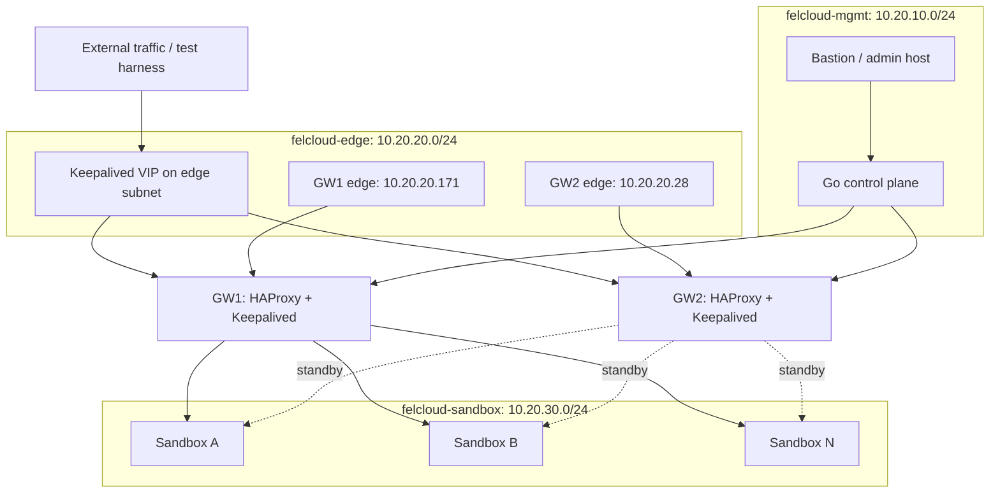

# Architecture Overview

This document supersedes the stale implementation notes that still referenced a FastAPI + Redis + SSH control path. The live design for this project is a Go-based control plane backed by PostgreSQL, Pulumi-managed OpenStack networking, and HAProxy's Data Plane API (DPA) for config pushes and rollback.

## 1. Current deployment topology

## 2. Responsibilities by layer

- Infrastructure: Pulumi + OpenStack
  - Networks: felcloud-edge, felcloud-sandbox, felcloud-mgmt
  - Neutron router attached only to the edge network
  - Security groups enforce the required gateway/sandbox/management separation
  - VIP reservation exists as an unbound port and is exposed to gateway edge interfaces via allowed address pairs

- Control plane: Go services
  - Postgres stores leases, routes, and generation metadata
  - IPAM enforces transactional allocation and quarantine rules
  - Routing and lifecycle components manage sandbox lifecycle and teardown ordering
  - HAProxy config generation and DPA commits are generation-aware and rollback-capable

- Data plane: HAProxy + Keepalived
  - Keepalived owns the VIP and active/standby election
  - HAProxy responds to tenant host headers and routes to sandbox backends
  - DPA is the API used for config validation and commit, not SSH-based editing

## 3. Network and identity facts

The live FelCloud values already reflected in the repo are:

- Edge network: 10.20.20.0/24
- Sandbox network: 10.20.30.0/24
- Management network: 10.20.10.0/24
- External router network: INTERNET (ID 470acab9-0e2a-4602-a8c8-9ab95ed6f24e)
- GW1 edge IP: 10.20.20.171
- GW2 edge IP: 10.20.20.28
- GW1 management IP: 10.20.10.145
- GW2 management IP: 10.20.10.54
- Image: Ubuntu 24.04 LTS (a049a501-f812-4e6c-9c07-61aa3b08bb50)
- Flavor: G0.basic.2c2g
- Keypair: felcloud-resilient-v2

The VIP address and the exact reservation-port UUID should be treated as runtime-discovery values and must be captured from the current OpenStack state using the discovery script in [scripts/discover-felcloud.sh](scripts/discover-felcloud.sh) rather than hardcoded in docs or code.

## 4. Operational model

1. Pulumi declares the static network, router, security groups, VIP reservation, and gateway instances.
2. The Go control plane allocates addresses, creates route records, and moves sandboxes through the required lifecycle states.
3. HAProxy config is generated deterministically and proposed as a generation.
4. Both gateways validate the candidate config via DPA before commit.
5. If validation fails on either gateway, the previous generation remains active and the failed generation is rolled back.
6. Live failover is validated through Keepalived, VIP movement, and end-to-end host-header traffic checks.

## 5. Delivered Phase 9 artifacts

- [docs/architecture.md](docs/architecture.md)
- [.env.example](.env.example)
- [scripts/discover-felcloud.sh](scripts/discover-felcloud.sh)
- [scripts/failover-test.sh](scripts/failover-test.sh)
- [scripts/recycle-test.sh](scripts/recycle-test.sh)

These artifacts standardize discovery, environment wiring, and failover/recycling checks for the live FelCloud environment without depending on the stale plan text.
