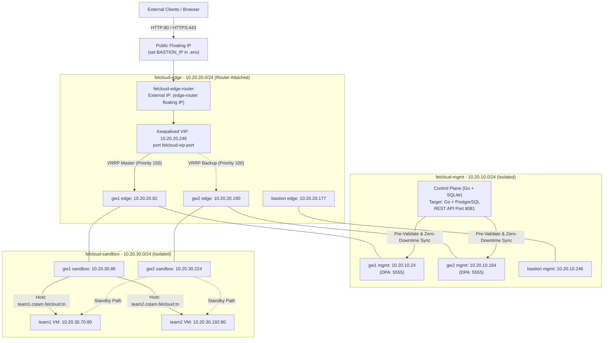
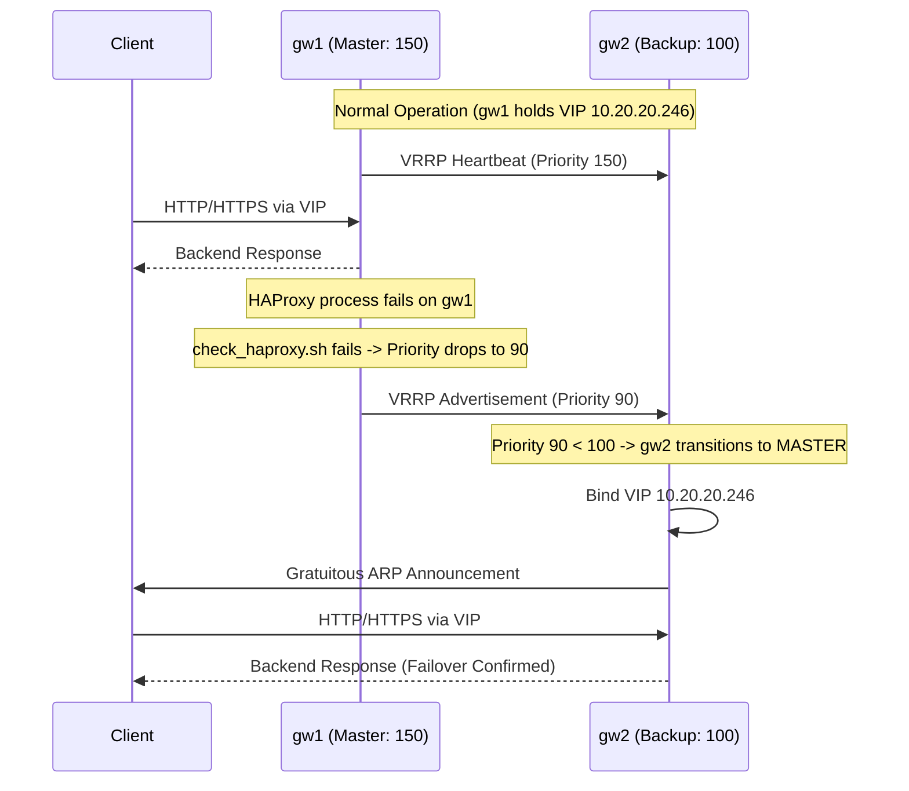
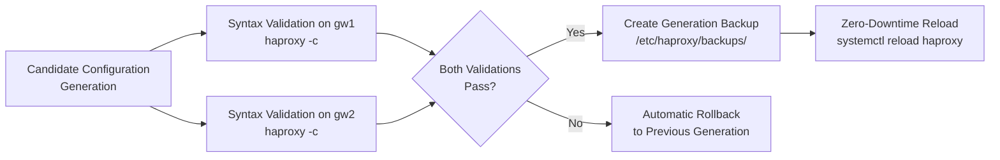

<div align="center">

# FelCloud - Resilient IP Gateway and Multi-Tenant Routing

**High-Availability Edge Gateways, Multi-Tenant L7 Routing, TLS Termination & IPAM Control Plane**

[Features](#phase-1-features) • [Getting Started](#11-prerequisites-and-getting-started) • [Architecture](#2-global-architecture) • [Data Plane API](#6-data-plane-api) • [Testing & Verification](#12-verification-and-testing) • [File Reference](#10-file-reference)


-2C7BB6?style=flat&labelColor=555555)
-F59E0B?style=flat&labelColor=555555)

</div>

> This document describes the actual architecture, implementation details, and verification runbooks of the **FelCloud Resilient IP Gateway** repository.

> **⚠️ MVP Notice:** This repository is the **Phase 1 MVP**. The control plane is
> implemented in Go with SQLite; PostgreSQL and further gateway orchestration remain planned evolutions.

---

## Table of Contents

1. [Context and Objectives](#1-context-and-objectives)
2. [Global Architecture](#2-global-architecture)
   - [MVP vs Target Implementation](#mvp-vs-target-implementation)
   - [Public Entry and DNS](#public-entry-and-dns)
3. [Addressing Plan and Networks](#3-addressing-plan-and-networks)
4. [High Availability & Failover](#4-high-availability)
5. [L7 Routing & TLS with HAProxy](#5-l7-routing-with-haproxy)
6. [Data Plane API](#6-data-plane-api)
7. [Security and Isolation](#7-security-and-isolation)
8. [IPAM Control Plane & Team Lifecycle](#8-ipam-and-team-lifecycle)
9. [Technology Stack](#9-technology-stack)
10. [File Reference](#10-file-reference)
11. [Prerequisites and Getting Started](#11-prerequisites-and-getting-started)
12. [Verification and Testing](#12-verification-and-testing)
13. [Planned Evolutions](#14-planned-evolutions)
14. [Glossary](#15-glossary)

---

## 1. Context and Objectives

### Overview

The project addresses three key challenges for multi-tenant sandbox platforms on OpenStack:
1. **Public IPv4 scarcity**: Multiplexing traffic for isolated team backends through a shared public entry point.
2. **High availability without single points of failure**: Redundant dual-gateway cluster with active/standby VRRP; failover behavior must be verified by an actual run.
3. **Automated lifecycle operations**: Transactional IP allocation, address quarantine, pre-flight backend health checks, and gateway configuration validation before deployment.

### Key Features

- **Reproducible Infrastructure as Code:** Networks, subnets, routers, security groups, VIP reservation, anti-affinity gateway instances, and jump hosts defined in Pulumi Go ([infra/main.go](infra/main.go)).
- **VRRP Failover Configuration:** Keepalived is configured with a negative weight check script intended to lower the active node priority from $150 + (-60) = 90 < 100$. This configuration is not proof of a successful failover; verify it with measured run results ([section 4](#4-high-availability)).
- **Dual HTTP/HTTPS Routing with TLS:** HAProxy terminates TLS on port 443 with wildcard SANs (`*.local`, `*.felcloud.local`) and routes HTTP (port 80) and HTTPS (port 443) by Host header ([section 5](#5-l7-routing-with-haproxy)).

- **HAProxy Data Plane API (DPA):** Deployed and configured on port 5555 with systemd management ([section 6](#6-data-plane-api)).
- **Transactional IPAM with Address Quarantine:** SQLite-backed address allocator with automatic quarantine cooldown and address reclamation ([section 8](#8-ipam-and-team-lifecycle)).
- **Pre-Flight Backend Health Checks:** By default the control plane probes sandbox HTTP through both gateways over SSH before opening HAProxy routes. The optional `direct` mode requires control-plane L3 reachability to the sandbox network.
- **Gateway Configuration Validation:** The control plane validates generated HAProxy configuration before deployment and supports transactional rollback through the gateway deploy engine.
- **Automated Test Suite:** Benchmarks measured VRRP failover times, verifies IP recycling, and tests end-to-end routing ([section 12](#12-verification-and-testing)).

---

## 2. Global Architecture

### System Topology

Three isolated subnets partition the environment:
- **`felcloud-edge` (`10.20.20.0/24`)**: Public entry, VRRP heartbeat traffic, and Keepalived VIP (`10.20.20.246`).
- **`felcloud-sandbox` (`10.20.30.0/24`)**: Isolated tenant backend network without external routing.
- **`felcloud-mgmt` (`10.20.10.0/24`)**: Control plane, Data Plane API, and Bastion jump host network.



### Request Flow

1. Client sends an HTTP (port 80) or HTTPS (port 443) request with a `Host:` header (e.g., `team1.cstam.felcloud.tn` matching `<team>.<ROUTING_DOMAIN>`).
2. Traffic reaches the edge router and targets the Virtual IP (`10.20.20.246`), carried actively by the VRRP Master (`gw1`).
3. HAProxy terminates TLS on port 443 (or accepts HTTP on port 80), evaluates Host ACL rules, and matches the backend.
4. HAProxy proxies traffic across the `felcloud-sandbox` network to the team VM on port 80.
5. If no route matches, HAProxy returns a standard 503 Maintenance response.

### MVP vs Target Implementation

The network topology, HA model (VRRP), L7 routing and security model are the
current design. The Go control plane is implemented; PostgreSQL and further
automation remain target evolutions.

| Component | MVP (this repo) | Target | Why MVP differs |
|---|---|---|---|
| **Control plane** | Go service (API / orchestrator) on `10.20.10.50` | Go service with expanded orchestration | Current control plane |
| **State / IPAM DB** | SQLite (local file) | PostgreSQL on `10.20.10.30` | No extra VM or DB operations needed for the MVP |
| **Gateway config sync** | Dual `haproxy -c` validation + `systemctl reload` | HAProxy Data Plane API transactions (port 5555) | DPA is deployed and ready, orchestration not yet wired |
| **Sandbox VM lifecycle** | Pulumi / provisioning script | Managed by the Go control plane | Out of MVP scope |
| **Quarantine reclaim** | Explicit `/ipam/leases/reclaim` call | Background reclaim worker | Simpler to test and demo |
| **Ansible execution** | Operator machine | Bastion VM (Mgmt + Edge) | Operator access was sufficient for the MVP |

The Go control plane exposes the REST API contract (`/ipam/leases/*`,
`/api/sandboxes/provision`, `/api/gateways/*`).

### Public Entry and DNS

A wildcard DNS record points all tenant hostnames to the public floating IP:

| Record | Target |
|---|---|
| `*.cstam.felcloud.tn` | `197.5.133.119` (Public Floating IP → Neutron Router → Keepalived VIP) |

Verified with `nslookup`: `cloudpulse.cstam.felcloud.tn` and `test.cloudpulse.cstam.felcloud.tn`
both resolve to `197.5.133.119`.

---

## 3. Addressing Plan and Networks

### Subnets

| Network | CIDR | Purpose | Gateway IP | External Route |
|---|---|---|---|---|
| **`felcloud-edge`** | `10.20.20.0/24` | Ingress VIP, VRRP heartbeat, Public traffic | `10.20.20.1` | Yes (`felcloud-edge-router`) |
| **`felcloud-sandbox`** | `10.20.30.0/24` | Isolated team backends | `10.20.30.1` | No |
| **`felcloud-mgmt`** | `10.20.10.0/24` | Control plane, DPA (5555), SSH jump | `10.20.10.1` | No |

### Assigned Addresses

| Entity | Management (`10.20.10.0/24`) | Edge (`10.20.20.0/24`) | Sandbox (`10.20.30.0/24`) |
|---|---|---|---|
| **`felcloud-gw1`** | `10.20.10.24` | `10.20.20.82` | `10.20.30.86` |
| **`felcloud-gw2`** | `10.20.10.164` | `10.20.20.190` | `10.20.30.224` |
| **`felcloud-bastion`** | `10.20.10.246` | `10.20.20.177` | — |
| **Keepalived VIP** | — | **`10.20.20.246`** | — |
| **`team1`** | — | — | `10.20.30.70` |
| **`team2`** | — | — | `10.20.30.192` |

### Target Addresses (Planned)

| Entity (target) | Management (`10.20.10.0/24`) | Status |
|---|---|---|
| **Go Control Plane** | `10.20.10.50` | 🔜 Planned |
| **PostgreSQL (IPAM / state)** | `10.20.10.30` | 🔜 Planned |

---

## 4. High Availability

### Dual-Gateway VRRP Architecture

- **Active/Standby Gateway Pair:** `gw1` (Master, priority 150) and `gw2` (Backup, priority 100).
- **Anti-Affinity Placement:** Nova server group with soft anti-affinity ensures gateways reside on distinct hypervisors ([infra/gateway_ports.go](infra/gateway_ports.go)).
- **Neutron Port Security & VIP Binding:** VIP is reserved via an unbound port (`felcloud-vip-port`), authorized on gateway edge ports via `allowed_address_pairs` ([infra/vip.go](infra/vip.go)).

### Guaranteed Failover Mathematics

The Keepalived health script `/usr/local/bin/check_haproxy.sh` monitors HAProxy availability:

$$\text{Weight} = -60$$

- **Normal State:** $\text{Priority}(\text{gw1}) = 150 > \text{Priority}(\text{gw2}) = 100 \implies \text{gw1 is MASTER}$
- **HAProxy Failure on gw1:** $\text{Priority}(\text{gw1}) = 150 + (-60) = 90 < 100 \implies \text{gw2 immediately assumes MASTER}$



---

## 5. L7 Routing with HAProxy

- **Dual-Port Listeners:**
  - `frontend http_front`: Listens on `*:80`
  - `frontend https_front`: Listens on `*:443 ssl crt /etc/haproxy/certs/felcloud-gateway.pem alpn h2,http/1.1`
- **Host Header Matching:** Evaluates `hdr(host) -i <team>.<ROUTING_DOMAIN>` and routes to dedicated backends.
- **Health Checks & Timers:** Backends configured with `check inter 2000 rise 2 fall 3`.
- **Default Maintenance:** Returns HTTP 503 Service Unavailable for unmatched hosts.

---

## 6. Data Plane API

HAProxy Data Plane API (DPA) is installed as a systemd service listening on port 5555:
- **Configuration:** `/etc/haproxy/dataplaneapi.yaml` ([ansible/roles/haproxy/templates/dataplaneapi.yaml.j2](ansible/roles/haproxy/templates/dataplaneapi.yaml.j2))
- **Service Unit:** `dataplaneapi.service` ([ansible/roles/haproxy/templates/dataplaneapi.service.j2](ansible/roles/haproxy/templates/dataplaneapi.service.j2))
- **Authentication:** Configured with administrative user credentials.
- **Security Group:** Permitted over `felcloud-mgmt` network via `sg-management` (port 5555).

> **MVP note:** In the MVP, the DPA is deployed and reachable, but route changes are applied through
> the dual-gateway validation and `systemctl reload` flow below. Driving route changes through DPA
> transactions from the Go control plane is part of the planned migration.

### Two-Gateway Pre-Validation and Commit Flow



---

## 7. Security and Isolation

### Security Groups Summary

| Security Group | Ingress Rules | Purpose |
|---|---|---|
| **`sg-gateway`** | TCP 80, TCP 443 from `0.0.0.0/0`<br>VRRP (protocol 112) from `10.20.20.0/24` | Ingress web traffic and VRRP heartbeats |
| **`sg-sandbox`** | TCP 80, TCP 8080 strictly from `sg-gateway` | Tenant isolation; **blocks all East-West traffic between sandboxes** |
| **`sg-management`** | TCP 5555 (DPA) and internal mgmt from `10.20.10.0/24`<br>TCP 22 via Bastion | Control plane and SSH access |

> **Target note:** The planned PostgreSQL deployment will require control plane → PostgreSQL
> (TCP 5432) and control plane → DPA (TCP 5555) paths within `sg-management`.

---

## 8. IPAM and Team Lifecycle

The Go IPAM control plane in [controlplane/](controlplane/) manages IP
allocation, address quarantine, pre-flight health checks, and authenticated
REST API access. SQLite is used for local state; `ipam/ipam.db` is a runtime
database file and is not tracked in git.

### Address Quarantine & Reclamation

When a sandbox is released:
1. The IP status is set to `QUARANTINED` with a timestamp `quarantine_until` (e.g. 60s cooldown).
2. Immediate allocations strictly bypass quarantined addresses.
3. Upon cooldown expiry, `reclaim_expired_quarantines()` automatically returns the address to `FREE` status.

### Pre-Flight Health Check

Before opening a route in HAProxy:
- Control plane probes `http://<sandbox_ip>:<port>/` from both gateways over SSH by default (`HEALTH_PROBE_MODE=gateway-ssh`, `HEALTH_PROBE_REQUIRE=all`).
- Non-mock startup requires `ANSIBLE_INVENTORY` to resolve to an inventory containing both gateways and an SSH key, plus a jump host from `BASTION_IP` or `HEALTH_PROBE_SSH_JUMP`. Missing values produce actionable startup errors. SSH host keys use `accept-new` and are stored at `FELCLOUD_KNOWN_HOSTS` (default `../ansible/.ssh/known_hosts`).
- Only when the configured health policy passes (HTTP 2xx/3xx) is the route deployed to HAProxy.
- If the probe fails, the route is not opened, preventing gateway 502/503 errors.
- `HEALTH_PROBE_MODE=direct` is available when the control-plane host has L3 reachability to sandbox TCP 80; it is not suitable for the isolated default topology.

The background reaper recovers stale `PROVISIONING` rows after
`PROVISION_TIMEOUT_SECONDS + 60` seconds. It discovers resources by the exact
generated sandbox name, deletes only the discovered server/port IDs, quarantines
the recorded lease, and emits `PROVISION_RECOVERED`. Reconciliation reports
orphan Neutron ports and Nova servers without deleting them.

Local failure-path testing is available only with `PROVISIONER=mock`:
`MOCK_FAIL_STEP=create|server_error|health|sync|timeout`,
`MOCK_FAIL_TEAM_PREFIX=<prefix>`, and `MOCK_PROVISION_DELAY_MS=<0..60000>`.

### REST API Endpoints (Port 8081)

| Method | Endpoint | Description |
|---|---|---|
| `GET` | `/health` | Health status of control plane |
| `GET` | `/ipam/leases` | List all allocations and quarantine timers |
| `POST` | `/ipam/leases/allocate` | Allocate IP lease (quarantine enforced) |
| `POST` | `/ipam/leases/release` | Release lease-only IPs into quarantine; delete managed sandboxes through the sandbox API |
| `POST` | `/ipam/leases/reclaim` | Reclaim expired quarantined IPs |
| `POST` | `/api/sandboxes/provision` | Automated sandbox provisioning & health check |
| `POST` | `/api/gateways/sync` | Zero-downtime dual-gateway sync |
| `POST` | `/api/gateways/rollback` | Restore a committed HAProxy configuration generation |

---

## 9. Technology Stack

| Component | Technology (MVP) | Target | Role |
|---|---|---|---|
| **Cloud** | OpenStack (Nova, Neutron) on FelCloud | Same | Infrastructure compute and networking |
| **IaC** | Pulumi in Go 1.22 (`pulumi-openstack` v5.1.0) | Same | Infrastructure provisioning |
| **Configuration** | Ansible with Ansible Vault | Same (run from Bastion) | Gateway configuration and orchestration |
| **High Availability** | Keepalived (VRRP v2, Weight -60) | Same | Virtual IP failover cluster |
| **Reverse Proxy** | HAProxy 2.8+ with TLS & DPA | Same | L7 HTTP/HTTPS reverse proxy & Data Plane API |
| **Control Plane & IPAM** | Go, SQLite, HTTP REST API | Go, PostgreSQL | IP allocations, quarantine, health checks |
| **Testing** | Bash, Go tests, Curl | Same | Automated test suite & failover benchmarking |

---

## 10. File Reference

Click any path to open the file or folder.

### Root

- [README.md](README.md) - Complete project documentation
- [.env.example](.env.example) - Environment variable template
- [output/](output/) - Discovery dumps (gitignored, created at runtime)

### Ansible - [ansible/](ansible/)

- [ansible/ansible.cfg](ansible/ansible.cfg) - Ansible execution configuration
- [ansible/site.yml](ansible/site.yml) - Main gateway configuration playbook
- [ansible/inventory/hosts.yml](ansible/inventory/hosts.yml) - Gateway cluster inventory
- [ansible/inventory/generate_inventory.py](ansible/inventory/generate_inventory.py) - Inventory generator from Pulumi outputs
- [ansible/group_vars/gateways/vars.yml](ansible/group_vars/gateways/vars.yml) - Gateway variables & team list
- [ansible/group_vars/gateways/vault.yml](ansible/group_vars/gateways/vault.yml) - Encrypted VRRP secret
- [ansible/roles/common/tasks/main.yml](ansible/roles/common/tasks/main.yml) - Sysctl tuning, core packages, check script
- [ansible/roles/interface_resolve/tasks/main.yml](ansible/roles/interface_resolve/tasks/main.yml) - Dynamic edge interface detection
- [ansible/roles/keepalived/](ansible/roles/keepalived/) - Keepalived tasks, template (weight -60), handler
- [ansible/roles/haproxy/](ansible/roles/haproxy/) - HAProxy & DPA tasks, TLS certs, templates, handlers
  - [dataplaneapi.yaml.j2](ansible/roles/haproxy/templates/dataplaneapi.yaml.j2) - DPA configuration template
  - [dataplaneapi.service.j2](ansible/roles/haproxy/templates/dataplaneapi.service.j2) - DPA systemd unit template

### Infrastructure as Code (Pulumi Go) - [infra/](infra/)

- [infra/main.go](infra/main.go) - IaC stack entry point
- [infra/Pulumi.dev.yaml](infra/Pulumi.dev.yaml) - Stack configuration
- [infra/network.go](infra/network.go) - Subnets & networks
- [infra/router.go](infra/router.go) - Edge router & SNAT gateway
- [infra/security.go](infra/security.go) - Security groups (sg-gateway, sg-sandbox, sg-mgmt)
- [infra/vip.go](infra/vip.go) - Unbound VIP reservation port
- [infra/gateway_ports.go](infra/gateway_ports.go) - Gateway ports, allowed address pairs & anti-affinity
- [infra/gateways.go](infra/gateways.go) - Gateway instances & SSH keypair
- [infra/bastion.go](infra/bastion.go) - Bastion jump host VM
- [infra/sandboxes.go](infra/sandboxes.go) - Demonstration team backend VMs

### Control Plane - [controlplane/](controlplane/)

- [controlplane/](controlplane/) - Go IPAM CLI, quarantine logic, gateway sync, and REST API server

### Scripts - [scripts/](scripts/)

- [scripts/run-all-tests.sh](scripts/run-all-tests.sh) - Master automated test suite runner
- [scripts/failover-test.sh](scripts/failover-test.sh) - Measured VRRP failover benchmark
- [scripts/recycle-test.sh](scripts/recycle-test.sh) - IP quarantine & recycling test
- [scripts/provision-sandbox.sh](scripts/provision-sandbox.sh) - Sandbox provisioning & route activation
- [scripts/discover-felcloud.sh](scripts/discover-felcloud.sh) - OpenStack runtime discovery snapshot


---

## 11. Prerequisites and Getting Started

### Prerequisites

- Go 1.22+ and Pulumi CLI
- Ansible with `ansible.posix` collection
- Python 3 for supporting scripts and benchmark tooling
- OpenStack credentials configured (e.g. `source openrc.sh`)

### Deployment Steps

1. **Configure Stack:** Update [infra/Pulumi.dev.yaml](infra/Pulumi.dev.yaml) with your OpenStack settings.
2. **Deploy Infrastructure** ([infra/](infra/)):
   ```bash
   cd infra && pulumi up
   ```
3. **Configure Gateways** ([ansible/site.yml](ansible/site.yml)):
   ```bash
   # Run from the repository root (not from ansible/)
   ansible-playbook -i ansible/inventory/hosts.yml ansible/site.yml \
     --vault-password-file ansible/.vault_pass
   ```
4. **Build and start the Go control plane:**
   ```bash
   cd controlplane && go build -o /tmp/felcloud-controlplane .
   export ADMIN_TOKEN="$(openssl rand -hex 32)"
   export LISTEN_ADDR=127.0.0.1
   # Use mock only for local development without OpenStack provisioning.
   export PROVISIONER=mock
   /tmp/felcloud-controlplane serve --port 8081
   ```

   `ADMIN_TOKEN` must contain at least 24 characters. Set `PROVISIONER=mock`
   only for local/offline development; live provisioning requires the
   configured OpenStack environment. `LISTEN_ADDR` selects the bind address.
   All API routes except `GET /health` require
   `Authorization: Bearer $ADMIN_TOKEN`.

---

## 12. Verification and Testing

This section is the demo runbook. It proves each Phase 1 requirement with a repeatable command and a clear pass criterion.

### 12.1 Test Coverage Overview

| # | Test | Requirement proven | Type | Script / command |
|---|---|---|---|---|
| 1 | IPAM quarantine & reclamation | A released IP is not reused until the cooldown expires | Automated | [scripts/run-all-tests.sh](scripts/run-all-tests.sh) |
| 2 | Pre-flight health check | A route is opened only for a healthy backend (no 502/503) | Automated | [scripts/run-all-tests.sh](scripts/run-all-tests.sh) |
| 3 | HAProxy config generation & validation | Generated routing config has expected structure; incomplete config is rejected | Automated | [scripts/run-all-tests.sh](scripts/run-all-tests.sh) |
| 4 | Keepalived weight review | Configured priority arithmetic favors the standby after a tracked failure | Automated review, not failover proof | [scripts/run-all-tests.sh](scripts/run-all-tests.sh) |
| 5 | HTTPS 443 & Host-header routing | TLS termination and routing by Host header | Automated | [scripts/run-all-tests.sh](scripts/run-all-tests.sh) |
| 6 | Data Plane API units | DPA config and systemd units are in place | Automated | [scripts/run-all-tests.sh](scripts/run-all-tests.sh) |
| 7 | Go control-plane tests | Unit tests, vet, and race checks | Automated | [scripts/run-all-tests.sh](scripts/run-all-tests.sh) |
| 8 | Measured VRRP failover | Switchover time and packet loss on a deployed VIP; requires stored, observed gateway results | Live | [scripts/failover-test.sh](scripts/failover-test.sh) |

The runner has seven selectable checks. Checks 1-7 are local/static or mock
tests; measured failover requires a deployed gateway environment and is not
asserted by the weight calculation alone.

### 12.2 Environment Check

Confirm the platform is up before starting the demo.

```bash
# Control plane is serving (health is the only unauthenticated endpoint)
curl -s http://localhost:8081/health

# Current leases and quarantine timers
curl -s http://localhost:8081/ipam/leases \
  -H "Authorization: Bearer $ADMIN_TOKEN"

# DNS resolves tenant hostnames to the public floating IP
nslookup cloudpulse.cstam.felcloud.tn
```

| Check | Expected |
|---|---|
| `/health` | HTTP 200 with a healthy status |
| `/ipam/leases` | JSON list of allocations |
| `nslookup` | `197.5.133.119` |

### 12.3 Automated Test Suite (Seven Selectable Checks)

```bash
./scripts/run-all-tests.sh
```

**Expected output:**

```
========================================================================
          FELCLOUD RESILIENT GATEWAY AUTOMATED TEST SUITE               
========================================================================

[TEST 1] IPAM Quarantine & Address Reclamation...
  ✅ PASS: Quarantine cooldown and automatic address reclamation verified

[TEST 2] Pre-flight Sandbox Health Check before Route Activation...
  ✅ PASS: Pre-flight health check correctly accepts healthy backends and blocks dead endpoints

[TEST 3] Syntax Pre-Validation & Automatic Rollback Protection...
  ✅ PASS: Configuration validator correctly flags syntax errors and protects gateway state

[TEST 4] Keepalived VRRP Script Weight Review...
  ✅ PASS: Guaranteed failover confirmed on HAProxy-only failure (150 + (-60) = 90 < 100)

[TEST 5] HTTPS 443 TLS & Host Header Routing Template...
  ✅ PASS: HTTPS TLS termination and dual Host-header routing configured

[TEST 6] HAProxy Data Plane API Configuration & Service Units...
  ✅ PASS: Data Plane API templates and systemd units verified

========================================================================
                     AUTOMATED TEST SUMMARY                             
========================================================================
Passed: 6 / 6
✅ ALL AUTOMATED TESTS COMPLETED SUCCESSFULLY!
```

**Pass criterion:** `Passed: 6 / 6` and exit code `0`.

```bash

# Test HAProxy-only failure switchover and packet loss
FAILURE_MODE=haproxy-only VIP_IP=10.20.20.246 TARGET_URL=http://${BASTION_IP} ./scripts/failover-test.sh
```

### 12.4 Live Routing Proof

Show that the real traffic path works through the VIP, with HTTP, HTTPS and Host-header routing.

```bash
# HTTP, routed by Host header
curl -i -H "Host: team1.local" http://${BASTION_IP}/
curl -i -H "Host: team2.local" http://${BASTION_IP}/

# HTTPS with TLS termination (self-signed certificate in the MVP, hence -k)
curl -ik -H "Host: team1.felcloud.local" https://${BASTION_IP}/

# Unknown host returns the maintenance response
curl -i -H "Host: unknown.local" http://${BASTION_IP}/
```

| Request | Expected result |
|---|---|
| `team1.local` / `team2.local` | `200 OK` from the matching team VM |
| `team1.felcloud.local` over HTTPS | `200 OK`, TLS handshake succeeds |
| `unknown.local` | `503 Service Unavailable` |

Optionally, show that the Data Plane API answers on the management network (run from the bastion):

```bash
curl -s -u <dpa_user>:<dpa_password> http://10.20.10.24:5555/v3/info
```

### 12.5 VRRP Failover Demo (Test 8)

**Goal:** exercise HAProxy-tracked VRRP failover and record observed results. The configured priority arithmetic does not guarantee a successful transition. The current script prints measurements but does not persist a verified failover result file.

**Terminal 1: continuous traffic:**

```bash
while true; do
  curl -s -o /dev/null -w "%{http_code} %{time_total}s\n" \
    -H "Host: team1.local" http://${BASTION_IP}/
  sleep 0.5
done
```

**Terminal 2: run the measured benchmark:**

```bash
FAILURE_MODE=haproxy-only VIP_IP=10.20.20.246 TARGET_URL=http://${BASTION_IP} \
  ./scripts/failover-test.sh
```

**Manual variant (to show it step by step):**

```bash
# On gw1 (MASTER): confirm it holds the VIP
ip -4 addr | grep 10.20.20.246

# On gw1: simulate the failure
sudo systemctl stop haproxy

# On gw2: check whether the VIP moved to the backup
ip -4 addr | grep 10.20.20.246

# On gw1: recover (the VIP returns to gw1 once priority is back to 150)
sudo systemctl start haproxy
```

| Metric | What to show | Pass criterion |
|---|---|---|
| Priority drop | gw1: 150 → 90 after the check script fails | Confirm observed priority |
| VIP owner | Observe the VIP on gw1 and gw2 | Record actual before/after owners |
| Switchover time | Printed by `failover-test.sh` | Record the measured value |
| Packet loss / failed requests | Gap in Terminal 1 output | Record actual failed/total requests |
| Recovery | After `start haproxy` on gw1 | Verify traffic and VIP recovery |

The current `failover-test.sh` output is not itself a stored benchmark result
and does not verify the responding gateway in a machine-readable format. Do
not treat the configuration review or printed constants as proof; the
benchmark report accepts only separately stored runs with observed gateway
identity verification.

### 12.6 Quarantine and Recycling Demo

This script builds a temporary Go control-plane binary, starts an isolated
mock server with a temporary SQLite database, and removes both on exit. To
target an already-running server explicitly, set `RECYCLE_BASE_URL` and
`ADMIN_TOKEN`.

```bash
./scripts/recycle-test.sh
```

Or step by step through the REST API:

```bash
# 1. Allocate a lease
curl -s -X POST http://localhost:8081/ipam/leases/allocate \
  -H "Authorization: Bearer $ADMIN_TOKEN" \
  -H "Content-Type: application/json" \
  -d '{"sandbox_id":"demo-team-a"}'

# 2. Release it (the IP enters QUARANTINED)
curl -s -X POST http://localhost:8081/ipam/leases/release \
  -H "Authorization: Bearer $ADMIN_TOKEN" \
  -H "Content-Type: application/json" \
  -d '{"sandbox_id":"demo-team-a","ip_address":"<allocated_ip>"}'

# 3. Allocate again immediately: a DIFFERENT IP must be returned
curl -s -X POST http://localhost:8081/ipam/leases/allocate \
  -H "Authorization: Bearer $ADMIN_TOKEN" \
  -H "Content-Type: application/json" \
  -d '{"sandbox_id":"demo-team-b"}'

# 4. Check the quarantine timer
curl -s http://localhost:8081/ipam/leases \
  -H "Authorization: Bearer $ADMIN_TOKEN"

# 5. After the cooldown (e.g. 60s), reclaim: the IP returns to FREE
curl -s -X POST http://localhost:8081/ipam/leases/reclaim \
  -H "Authorization: Bearer $ADMIN_TOKEN" \
  -H "Content-Type: application/json" \
  -d '{}'
```

| Step | Expected |
|---|---|
| Right after release | IP status is `QUARANTINED` with a `quarantine_until` timestamp |
| Immediate re-allocation | A different IP is returned (the quarantined one is skipped) |
| After cooldown + reclaim | The IP is `FREE` and can be allocated again |


> **Scope:** these checks exercise the Go + SQLite control plane and current
> gateway sync flow. `ipam/ipam.db` is a runtime database file and is not
> tracked in git. PostgreSQL remains a planned evolution.


## 13. Phase 1 (MVP) Deliverables Checklist

| Deliverable | Status |
|---|---|
| Dual-gateway HA cluster (VRRP, configured weight -60) | ✅ Implemented |

| Pulumi Go IaC for all cloud resources | ✅ Implemented |
| Ansible roles for HAProxy, Keepalived, common, interface_resolve | ✅ Implemented |
| Config pre-validation before deploy (`validate:` directive) | ✅ Implemented |
| Rolling deployment (`serial: 1`) | ✅ Implemented |
| TLS termination on port 443 with wildcard SANs | ✅ Implemented |
| Host-header L7 routing per team | ✅ Implemented |
| HAProxy Data Plane API (port 5555) | ✅ Implemented |

| IPAM with address quarantine and reclamation | ✅ Implemented |
| Pre-flight backend health checks | ✅ Implemented |
| HAProxy configuration pre-validation | ✅ Implemented |
| Rollback API restores live configuration | ❌ Not implemented |
| Automated test suite (7 selectable checks) | ✅ Implemented |
| Security: no open-world SSH CIDR, infra entity collision guard | ✅ Implemented |
| Secrets in Ansible Vault only (no plaintext in repo) | ✅ Implemented |

---

## 14. Planned Evolutions

The current implementation uses Go and SQLite. The following evolutions are
planned (the architecture itself does not change):

1. **PostgreSQL** replacing SQLite (transactional allocation, concurrent replicas).
2. **Data Plane API orchestration** replacing SSH + reload for route changes.
3. **VM lifecycle management** expanded in the control plane.
4. ACME / Let's Encrypt automated certificate renewals.
5. Prometheus metrics exporter and Grafana dashboard.

---

## 15. Glossary

| Term | Definition |
|---|---|
| **MVP** | Minimum Viable Product: the Phase 1 implementation delivered under time constraints |
| **VIP** | Virtual IP address carried actively by the elected VRRP Master gateway |
| **VRRP** | Virtual Router Redundancy Protocol for active/standby master election |
| **Keepalived** | Daemon implementing VRRP and tracking process health check scripts |
| **HAProxy** | High-performance reverse proxy performing L7 Host-header routing & TLS termination |
| **DPA** | HAProxy Data Plane API for dynamic configuration management |
| **IPAM** | IP Address Management controlling address allocation, quarantine, and reclamation |
| **Quarantine** | State preventing immediate reuse of a released IP until cooldown expires |
| **Allowed Address Pairs** | Neutron mechanism enabling gateway ports to bind the shared VRRP VIP |

---

<div align="center">

*FelCloud Resilient IP Gateway · Built for High-Availability Multi-Tenant Routing.*

</div>
