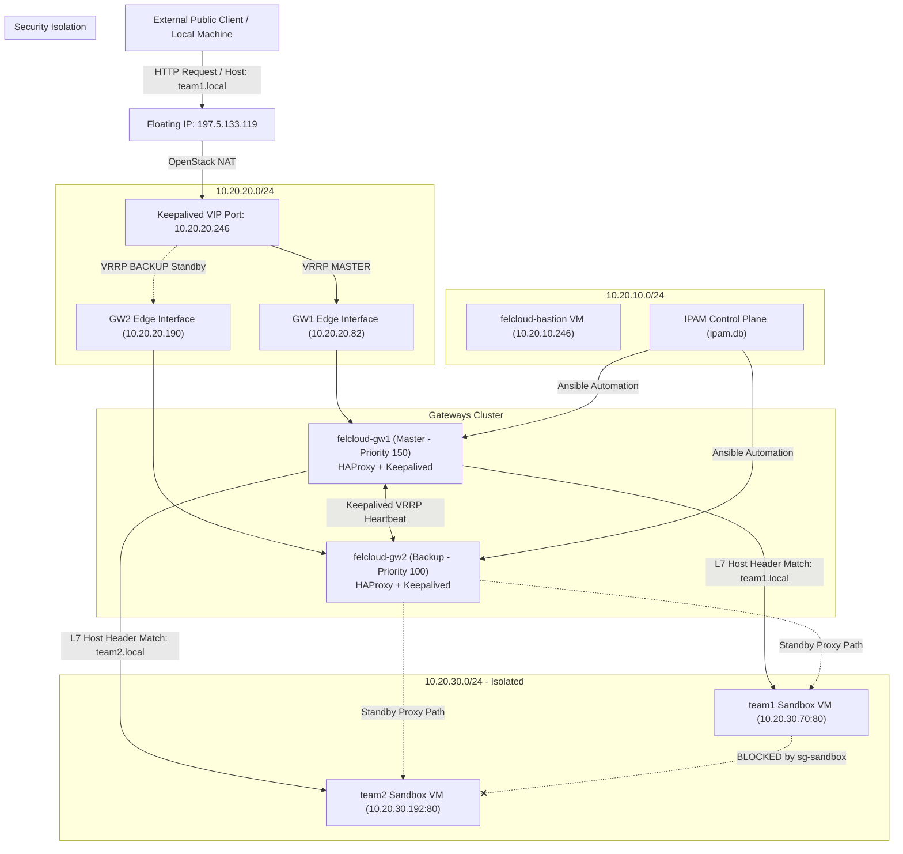

# Global Architecture & Implementation Plan
## Resilient IP Gateway & Multi-Tenant Routing Solution (Phases 1 – 8)

---

## 1. High-Level System Architecture

The Resilient IP Gateway solution provides a **High-Availability (HA), Multi-Tenant, Zero-Downtime Gateway System** built on OpenStack, managed via **Pulumi (Go IaC)**, **Ansible**, and a custom **Relational IPAM Control Plane**.



---

## 2. IPAM & Subnet Topology Matrix

The solution partitions the OpenStack tenant network into **three dedicated `/24` subnets**:

| Subnet Name | CIDR | Purpose | Assigned IP Addresses |
| :--- | :--- | :--- | :--- |
| **`felcloud-mgmt`** | `10.20.10.0/24` | Isolated Management Control Plane & SSH Jump | `gw1`: `10.20.10.24`<br>`gw2`: `10.20.10.164`<br>`bastion`: `10.20.10.246` |
| **`felcloud-edge`** | `10.20.20.0/24` | Public Gateway & Keepalived VRRP Traffic | `gw1`: `10.20.20.82`<br>`gw2`: `10.20.20.190`<br>`bastion`: `10.20.20.177`<br>**`VIP`**: `10.20.20.246` |
| **`felcloud-sandbox`** | `10.20.30.0/24` | Multi-Tenant Isolated Team Backends | `gw1`: `10.20.30.86`<br>`gw2`: `10.20.30.224`<br>`team1`: `10.20.30.70`<br>`team2`: `10.20.30.192` |

---

## 3. Phased Implementation Roadmap

### Phase 1: Networks & Subnets Infrastructure
- Created three isolated OpenStack networks (`edge`, `sandbox`, `mgmt`) with non-overlapping `/24` subnets.

### Phase 2: Edge Router & Public SNAT Gateway
- Provisioned `felcloud-edge-router` connected to external gateway IP `197.5.133.110` for outbound SNAT internet connectivity.

### Phase 3: Security Groups & Isolation Policies
- **`sg-gateway`**: Permits HTTP (80/tcp), HTTPS (443/tcp), and VRRP protocol 112 between gateway edge interfaces.
- **`sg-sandbox`**: Permits HTTP (80/tcp) **strictly from gateway instances**. **Blocks all inter-sandbox traffic**.
- **`sg-management`**: Permits internal control plane communication and admin access.

### Phase 4: Virtual IP (VIP) & Gateway Interfaces
- Created unbound reservation port `felcloud-vip-port` (`10.20.20.246`).
- Configured `allowed_address_pairs` on gateway edge ports to allow VIP binding without Neutron IP spoofing drops.

### Phase 5: Gateway & Bastion Compute Deployment
- Provisioned anti-affinity gateway instances (`felcloud-gw1` & `felcloud-gw2`) and `felcloud-bastion` jump host using Nova compute.

### Phase 6: High Availability & VRRP Failover (Keepalived)
- Configured Keepalived on both gateways:
  - `gw1`: MASTER (Priority 150)
  - `gw2`: BACKUP (Priority 100)
- Integrated automated health check tracking script `/usr/local/bin/check_haproxy.sh`.

### Phase 7: Layer 7 Multi-Tenant Reverse Proxy (HAProxy)
- Configured HAProxy on port 80 with HTTP `Host:` header ACL matching:
  - `Host: team1.local` $\rightarrow$ `team1_backend` (`10.20.30.70:80`)
  - `Host: team2.local` $\rightarrow$ `team2_backend` (`10.20.30.192:80`)

### Phase 8: Dynamic IPAM Control Plane & Team Onboarding CLI
- Built relational database `ipam/ipam.db` (`subnets` and `ip_allocations` tables).
- Created management CLI `ipam/ipam_control.py` for dynamic team onboarding (`add-team`, `remove-team`, `list`, `sync`).

---

## 4. Layer Separation Architecture

```
Layer 3 / 4 (IP / VRRP)           Layer 7 (HTTP Application)
┌───────────────────────────┐      ┌───────────────────────────┐
│ Keepalived (VRRP)         │      │ HAProxy Reverse Proxy     │
│ - Manages VIP 10.20.20.246│      │ - Listens on 0.0.0.0:80  │
│ - Active/Backup Failover  │      │ - Evaluates Host: Headers │
│ - GW1 (150) / GW2 (100)   │      │ - Routes to Sandboxes     │
└─────────────┬─────────────┘      └─────────────┬─────────────┘
              │                                  │
              ▼                                  ▼
      High Availability                  Traffic Routing
```

---

## 5. Security & Isolation Matrix

1. **Zero East-West Inter-Sandbox Communication:**
   - Sandboxes (`team1`, `team2`) belong to `sg-sandbox`.
   - `sg-sandbox` has no ingress rule from `sg-sandbox`.
   - Packet drops occur at the hypervisor tap interface if `team1` attempts to reach `team2`.

2. **Management Control Plane Isolation:**
   - Gateway management interfaces (`10.20.10.0/24`) are inaccessible from the `sandbox` network.

---

## 6. Verification Runbook

### 1. Test Host Routing via Public Floating IP (`197.5.133.119`)
```bash
# Request to Team 1 Sandbox
curl -s -H "Host: team1.local" http://197.5.133.119
# Output: Hello from team1 sandbox!

# Request to Team 2 Sandbox
curl -s -H "Host: team2.local" http://197.5.133.119
# Output: Hello from team2 sandbox!
```

### 2. Verify IPAM Control Plane
```bash
cd /home/ben-slimene-nour-el-houda/ip_resilien/ipam
python3 ipam_control.py list
```

### 3. Test Live Gateway Failover
```bash
# Stop keepalived on gw1
ansible -i inventory/hosts.yml gw1 -a "systemctl stop keepalived" -b

# Verify VIP shifted to gw2 and HTTP requests continue working
curl -s -H "Host: team1.local" http://197.5.133.119

# Restore keepalived on gw1
ansible -i inventory/hosts.yml gw1 -a "systemctl start keepalived" -b
```
