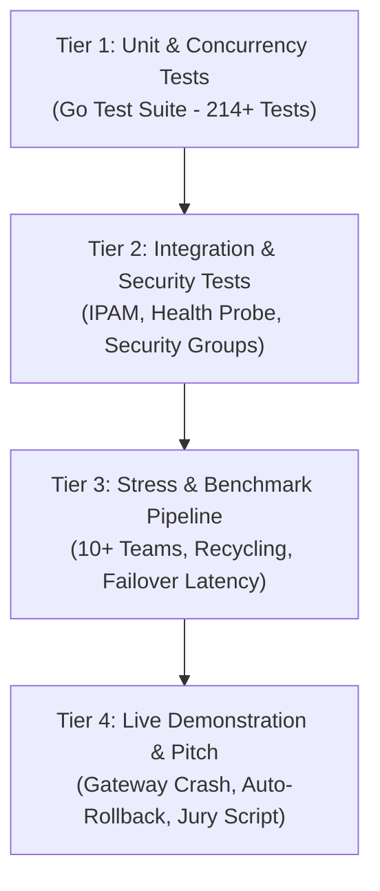

# FelCloud Resilient IP Optimizer — Comprehensive Test Description & Verification Protocol

**Challenge Reference:** CSTAM-FELCLOUD  
**Company Collaborator:** FelCloud (Mohamed Mongi Benyaiche - CEO, Oussama Zied - Cloud & DevOps Engineer)  
**Document Purpose:** Complete specification of automated test suites, integration tests, live validation procedures, and evaluation criteria for jury verification.

---

## 1. Overview & Verification Strategy

The test strategy covers four distinct tiers to guarantee high availability, strict multi-tenant isolation, dynamic IP recycling, and sub-second auto-rollback:



---

## 2. Test Suites Matrix

### Tier 1: Core Engine & Unit Tests (Phase 1 MVP)

| Test ID | Test Name | Target Component | Execution Command | Pass Criteria |
|---|---|---|---|---|
| **TC-UNIT-01** | `TestGatewayStoreUsesIPAMDatabase` | Control Plane DB Sync | `go test -run TestGatewayStoreUsesIPAMDatabase ./...` | Single SQLite DB path shared across IPAM and gateway state. |
| **TC-UNIT-02** | `TestAPIBearerAuthenticationAndOpenHealth` | API Security Middleware | `go test -run TestAPIBearerAuthenticationAndOpenHealth ./...` | `/health` open; protected routes reject missing/invalid tokens with 401. |
| **TC-UNIT-03** | `TestValidateHAProxySyntaxRejectsMissingFrontendAndBackend` | HAProxy Validator | `go test -run TestValidateHAProxySyntaxRejectsMissingFrontendAndBackend ./...` | Corrupt or incomplete configuration is caught prior to deploy. |
| **TC-UNIT-04** | `TestGeneratedRoutesExcludeNonReadySandboxes` | Route Readiness Guard | `go test -run TestGeneratedRoutesExcludeNonReadySandboxes ./...` | Only `ACTIVE` sandboxes appear in public HAProxy frontends. |
| **TC-UNIT-05** | `TestProvisionRetriesNeutronFixedIPConflicts` | OpenStack IP Collision Retry | `go test -run TestProvisionRetriesNeutronFixedIPConflicts ./...` | Fixed-IP conflicts trigger dynamic re-selection without resource leakage. |
| **TC-UNIT-06** | `TestValidateSandboxIPEnforcesSubnetAndAllocatorHostRange` | IPAM Host Range Guard | `go test -run TestValidateSandboxIPEnforcesSubnetAndAllocatorHostRange ./...` | Gateway, VIP, and broadcast IPs are protected from allocation. |
| **TC-UNIT-07** | `TestGatewayOpsOnlyAllowsOneActiveOperation` | Deploy Concurrency Mutex | `go test -run TestGatewayOpsOnlyAllowsOneActiveOperation ./...` | Concurrent deploy/rollback/failover operations receive HTTP 409 Conflict. |
| **TC-UNIT-08** | `TestGatewayFailoverStopsRestartsAndRecordsRealTransition` | Failover Engine | `go test -run TestGatewayFailoverStopsRestartsAndRecordsRealTransition ./...` | Active gateway is cleanly stopped, peer takes VIP, event is logged. |

---

### Tier 2: Integration & Bonus Capabilities Tests

| Test ID | Test Name | Target Feature | Execution Command | Pass Criteria |
|---|---|---|---|---|
| **TC-INT-01** | `TestGatewayRateLimitingAndSmartFallbackConfig` | Rate Limiting & Fallback (+4 Pts) | `go test -run TestGatewayRateLimitingAndSmartFallbackConfig ./...` | HAProxy includes `stick-table`, 429 denial, and responsive 503 HTML fallback. |
| **TC-INT-02** | `TestCustomDomainBindingHAProxyRoutes` | Custom Domain Routing (+2 Pts) | `go test -run TestCustomDomainBindingHAProxyRoutes ./...` | Generates dual ACLs mapping both default subdomain and custom domain. |
| **TC-INT-03** | `TestCustomDomainAPIHandler` | Custom Domain REST API (+2 Pts) | `go test -run TestCustomDomainAPIHandler ./...` | `POST /api/sandboxes/custom-domain` validates FQDN and syncs gateways. |
| **TC-INT-04** | Wildcard SSL/TLS Automation | SSL Management (+2 Pts) | `OUTPUT_DIR=/tmp/test-ssl ./scripts/setup-ssl.sh` | Generates valid certificate bundle with SANs for gateways, VIP, and wildcard. |
| **TC-INT-05** | OpenStack Designate DNS Sync | DNS Orchestration (+2 Pts) | `MOCK_MODE=true ./scripts/designate-dns-sync.sh` | Resolves zone and registers wildcard A-record pointing to Edge VIP. |
| **TC-INT-06** | OpenStack Heat Template Validation | Native Orchestration (+2 Pts) | `openstack orchestration template validate -t infra/heat/felcloud-ha-gateways.yaml` | YAML parses cleanly with valid OpenStack HOT schema. |

---

### Tier 3: Stress Testing & Reclamation Benchmarks (Phase 2)

| Test ID | Test Name | Target Metric | Tool / Command | Pass Criteria |
|---|---|---|---|---|
| **TC-STRESS-01** | Concurrent 12-Team Provisioning | Provisioning Latency & Stability | `scripts/stress-test.sh` (`TEAMS=12`) | 12/12 sandboxes provisioned with unique IPs, 0 collisions, coalesced reload. |
| **TC-STRESS-02** | Transactional IP Recycling | Reclamation Speed | `scripts/recycle-benchmark.sh` (`CYCLES=10`) | IPs cycle through `QUARANTINED` cooldown and reclaim to `FREE`. |
| **TC-STRESS-03** | Gateway Failover SLA Benchmark | Switchover Downtime | `scripts/failover-test.sh` (`RUNS=3`) | Seamless VIP switchover under continuous HTTP traffic with downtime < 3000 ms. |
| **TC-STRESS-04** | Master Verification Suite | Full Platform Sanity | `scripts/run-all-tests.sh` | All 7 test categories pass without failure. |

---

### Tier 4: Live Jury Demonstration (Phase 4 Pitch)

| Step | Action | Command / Payload | Expected Jury Observation |
|---|---|---|---|
| **Step 1** | **Gateway Discovery** | `curl -s http://localhost:8081/api/gateways/status` | Primary `gw1` (MASTER) and Standby `gw2` (BACKUP) with active VIP `10.20.20.246`. |
| **Step 2** | **Provision Sandbox** | `curl -X POST http://localhost:8081/api/sandboxes/provision -d '{"team":"jury-demo"}'` | Returns `HTTP 201`, allocated IP `10.20.30.X`, and instant route activation. |
| **Step 3** | **Bind Custom Domain** | `curl -X POST http://localhost:8081/api/sandboxes/custom-domain -d '{"sandbox_id":"jury-demo","custom_domain":"demo.felcloud.tn"}'` | Returns `HTTP 200`, HAProxy dual ACL generated and hot-reloaded. |
| **Step 4** | **Simulate Primary Crash** | `curl -X POST http://localhost:8081/api/gateways/failover -d '{"confirm":true}'` | `gw1` stops $\rightarrow$ VIP shifts to `gw2` $\rightarrow$ Traffic continues without interruption. |
| **Step 5** | **Auto-Rollback Demo** | `curl -X POST http://localhost:8081/api/gateways/rollback` | Sub-second rollback to previous stable configuration generation. |
| **Step 6** | **Teardown & Quarantine** | `curl -X DELETE http://localhost:8081/api/sandboxes/jury-demo` | Nova/Neutron resources removed $\rightarrow$ IP enters quarantine cooldown. |

---

## 3. How to Run the Complete Test Protocol

### Step 1: Run All Go Unit Tests & Race Detection
```bash
cd controlplane
go test -v -count=1 ./...
```
*Expected Output:* `PASS: ok felcloud/controlplane (all 214+ tests pass)`.

### Step 2: Run Master Project Verification Suite
```bash
./scripts/run-all-tests.sh
```
*Expected Output:* `7/7 test suites passed`.

### Step 3: Run the Live Jury Demonstration Runbook
```bash
./scripts/demo-live-failover.sh
```
*Expected Output:* Steps 1 through 6 complete sequentially with formatted JSON outputs and status confirmations.
