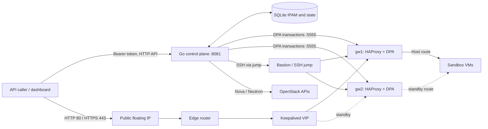
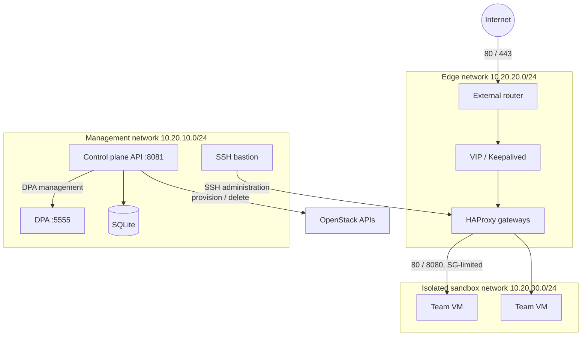

# FelCloud System Reference

This document describes the FelCloud implementation in this repository. It combines the control-plane API, sandbox lifecycle, gateway integration, infrastructure, and security model in one place. Where the repository contains an operational limitation or a difference between design intent and code, it is called out explicitly.

## 1. Introduction

### 1.1 Purpose

FelCloud provides isolated team sandboxes on OpenStack while conserving public IPv4 addresses. A Go control plane allocates sandbox addresses, provisions and tracks VMs, checks backend health, publishes routes to a redundant HAProxy gateway pair, and tears resources down with address quarantine. SQLite stores leases, lifecycle state, gateway generations, locks, and events.

### 1.2 System in One Paragraph

A caller sends authenticated requests to the control-plane HTTP API. For provisioning, the control plane reserves an IP in the sandbox pool, creates a Neutron port and Nova server, waits for Nova to report `ACTIVE`, probes the backend through the configured health path, records the sandbox as active, and synchronizes host-based HAProxy routes to both gateways. Clients reach a shared public floating IP and edge VIP; Keepalived elects one gateway to carry that VIP. On teardown, FelCloud removes routes, deletes only the recorded OpenStack server and port IDs, verifies deletion, and quarantines the address before it can be reused.

### 1.3 Scope and Reading Guide

- Sections 2 and 7 explain the topology and trust boundaries.
- Sections 3 and 4 describe the caller-facing API and workflows.
- Sections 5 and 6 describe gateway configuration, failover, and concurrency.
- `README.md` contains deployment and demo instructions; `docs/api-gateways.md` provides additional gateway response examples.
- `TEST_PLAN.md` and `HANDOFF.md` distinguish mock/static coverage from live OpenStack and gateway checks. Those live checks are not implied by this reference.

The control plane is Go with SQLite in this repository. PostgreSQL and some expanded orchestration are target evolutions rather than current components.

## 2. Architecture Overview

### 2.1 Component Diagram



The exact control-plane and OpenStack placement can vary by deployment. The diagram shows logical roles. The sandbox and management networks are not attached to the edge router; only the edge subnet is attached.

### 2.2 Component Table

| Component | Responsibility | Implementation / interface |
|---|---|---|
| Control plane | REST API, provisioning orchestration, health probes, reconciliation, lifecycle and gateway operations | Go service; default port `8081` (overridable with `PORT`) |
| IPAM/state store | Subnets, IP leases, sandboxes, events, gateway locks and config generations | SQLite; path configured by `IPAM_DB_PATH` or auto-detected |
| OpenStack | Nova servers, Neutron ports/networks/security groups and floating IP/router resources | Go OpenStack provisioner and Pulumi infrastructure project |
| Gateways | TLS termination, HTTP host routing, health checks and VIP failover | Two HAProxy + Keepalived instances; DPA on port `5555` |
| Bastion | SSH jump access for gateway administration and probes | OpenStack VM managed by Pulumi; deployment-dependent public reachability |
| Dashboard | Operator UI for sandboxes, leases, gateways, events and generations | React + TypeScript + Vite, served under `/ui/` when configured |
| Ansible | Gateway packages, HAProxy/DPA, Keepalived, certs and operational actions | Rolling gateway playbooks; inventory in `ansible/inventory/hosts.yml` |

### 2.3 Naming Conventions

- Sandbox/team IDs are lowercase DNS labels: 1–63 characters, letters and digits at the ends, with hyphens allowed internally. Example: `team-blue`.
- The default hostname is `<sandbox_id>.<ROUTING_DOMAIN>`; the repository default routing domain is `cstam.felcloud.tn`.
- Stable gateway names are `gw1` and `gw2`; these names also appear in event and failover payloads and in `X-Gateway-ID` responses.
- Network names are `felcloud-edge`, `felcloud-sandbox`, and `felcloud-mgmt`.
- Status and event names are uppercase / lowercase as returned by the API; use the values documented below rather than normalizing them on the client.

## 3. API Reference

Base URL: `http://<control-plane-host>:8081` by default. The repository's Go HTTP server does not itself configure TLS; deploy it behind an appropriately protected network or TLS-terminating proxy. All JSON request bodies are limited to 1 MiB, require one JSON object, and reject unknown fields.

Admin requests use `Authorization: Bearer <ADMIN_TOKEN>`, unless `AUTH_DISABLED=true` is explicitly configured. `CONTROL_PLANE_TOKEN` remains a deprecated startup fallback. See 7.3 for exceptions and public paths.

### 3.1 General Conventions

- JSON is used for request and response bodies. Send `Content-Type: application/json` for requests with a body.
- Mutating routes are rate-limited per client IP; the default is 30 requests per minute (`RATE_LIMIT_PER_MIN`). A rejected request returns `429` and `Retry-After: 60`.
- Provisioning and administrative APIs are synchronous from the caller's perspective, though a concurrent teardown can return `202` while the resource remains in `TEARING_DOWN`.
- Sandbox timestamps in list responses are database-formatted strings; `expires_at` is a Unix timestamp in seconds. Gateway event timestamps use Unix milliseconds.
- Errors are not completely uniform: most canonical control-plane endpoints use `{ "error", "detail", "code" }`; some lifecycle endpoints return additional fields such as `step`, `sandbox_id`, and `timings_ms`.

### 3.2 Endpoint Summary

| Method | Path | Purpose | Typical success |
|---|---|---|---|
| `GET` | `/health` | Process and database health | `200` |
| `GET` | `/api/config` | Public client configuration (routing domain, VIP, provisioner type) | `200` |
| `GET` | `/api/sandboxes` | List sandbox records | `200` |
| `POST` | `/api/sandboxes/provision` | Provision a sandbox | `201`; existing active sandbox may return `200` |
| `POST` | `/api/sandboxes/extend` | Extend sandbox TTL | `200` |
| `POST` | `/api/sandboxes/{id}/teardown` | Tear down a sandbox | `200`; in-progress duplicate `202` |
| `DELETE` | `/api/sandboxes/{id}` | Alias for teardown | `200` |
| `POST` | `/api/sandboxes/custom-domain` | Set or clear a sandbox custom domain | `200` |
| `GET` | `/api/leases`, `/ipam/leases` | List IP leases | `200` |
| `POST` | `/ipam/leases/allocate`, `/api/leases/allocate` | Allocate an IP lease directly | `201` |
| `POST` | `/ipam/leases/release`, `/api/leases/release` | Release a direct lease into quarantine | `200` |
| `POST` | `/ipam/leases/reclaim`, `/api/leases/reclaim` | Reclaim expired quarantines | `200` |
| `GET` | `/api/reconcile` | Read-only OpenStack/database drift report | `200` |
| `POST` | `/api/reconcile/apply` | Apply supported reconciliation actions | `200` |
| `GET` | `/api/events` | Read lifecycle events | `200` |
| `GET` | `/api/gateways/status` | Gateway, HAProxy, Keepalived and VIP state | `200` |
| `GET` | `/api/gateways/dpa` | DPA readiness | `200` |
| `GET` | `/api/gateways/logs` | Read gateway service logs | `200` |
| `GET`, `POST` | `/api/gateways/events` | Query or ingest gateway events | `200`, `201` |
| `GET` | `/api/gateways/generations` | List HAProxy config generations | `200` |
| `POST` | `/api/gateways/sync` | Generate and deploy gateway config | `200` |
| `POST` | `/api/gateways/rollback` | Restore a committed config generation | `200` |
| `POST` | `/api/gateways/failover` | Trigger and measure failover | `200` on success |
| `GET` | `/ui/` | Dashboard single-page application | `200` when configured |

### 3.3 Sandbox Resource

The sandbox is tracked in SQLite with a stable `sandbox_id`, generated hostname, subnet, IP, OpenStack resource IDs, lifecycle status, ownership, optional custom domain, and optional expiration. `GET /api/sandboxes` returns `{ "sandboxes": [...], "count": n }`. Entries include `id`, `sandbox_id`, `hostname`, `subnet_name`, `private_ip`, `status`, `created_at`, `updated_at`, `custom_domain`, `expires_at`, and `ttl_remaining_seconds`.

Lifecycle states include `REQUESTED`, `PROVISIONING`, `ACTIVE`, `EXPIRING`, `TEARING_DOWN`, `TEARDOWN_FAILED`, `FAILED`, `FAILED_HEALTH_CHECK`, `RELEASED`, and `ROLLBACK`. Only a sandbox whose `managed_by` is `control-plane` may be deleted by the teardown flow. Missing ownership defaults to `external` and is protected.

### 3.4 Provisioning a Sandbox

`POST /api/sandboxes/provision`

```json
{
  "team": "team-blue",
  "ttl": 14400,
  "custom_domain": "app.example.org"
}
```

`team` is the canonical identifier; `sandbox_id` is accepted as an alias if `team` is empty. `ttl` is optional and measured in seconds. The default is 14,400 seconds (4 hours), and the default maximum is 86,400 seconds (24 hours); these can be configured with `DEFAULT_TTL_SECONDS` and `MAX_TTL_SECONDS`. The custom domain is optional.

Successful response (`201`; repeated request for an already active sandbox can return `200`):

```json
{
  "sandbox_id": "team-blue",
  "team": "team-blue",
  "fixed_ip": "10.20.30.50",
  "server_id": "<nova-server-id>",
  "port_id": "<neutron-port-id>",
  "hostname": "team-blue.cstam.felcloud.tn",
  "state": "ACTIVE",
  "timings_ms": {
    "allocate": 10,
    "port": 20,
    "server_active": 3000,
    "health": 50,
    "sync": 1000,
    "total": 4500
  }
}
```

The IDs and timings above are illustrative. Health checking defaults to `gateway-ssh` for the real OpenStack provisioner and `skip` for the mock provisioner. `HEALTH_PROBE_MODE` supports configured modes such as `gateway-ssh`, `direct`, or `skip`; `HEALTH_PROBE_REQUIRE` controls whether all or any gateways must pass where applicable. A route is published only after backend health succeeds.

### 3.5 Reading, Renewing and Deleting

- **Read:** `GET /api/sandboxes` lists all records. `GET /api/leases` or `/ipam/leases` lists address allocation records and quarantine timestamps.
- **Renew:** `POST /api/sandboxes/extend` with `{"sandbox_id":"team-blue","extend_seconds":3600}`. The extension must satisfy `MIN_EXTEND_SECONDS` (default 60 seconds) and stay within the maximum TTL cap. Success includes `expires_at` and `ttl_remaining_seconds`.
- **Delete:** `POST /api/sandboxes/team-blue/teardown` with `{}` or `DELETE /api/sandboxes/team-blue`. Both enter the same guarded, resumable teardown path. A duplicate in-progress request returns `202`; an external/unowned sandbox returns `403`; an unknown sandbox returns `404`.
- **Custom domain:** `POST /api/sandboxes/custom-domain` with `{"sandbox_id":"team-blue","custom_domain":"app.example.org"}`. An empty domain clears it. The handler records an event and triggers a gateway sync.

### 3.6 Administrative Endpoints

- **Gateway status:** `GET /api/gateways/status` returns per-gateway reachability, HAProxy and Keepalived state, local VIP ownership, probe time, errors, VIP holder, latest generation, and deployment method. `?refresh=true` invalidates the short-lived cache.
- **DPA:** `GET /api/gateways/dpa` probes DPA readiness/version.
- **Logs:** `GET /api/gateways/logs?gateway=gw1&source=haproxy&limit=50&since=...`. Gateway must be `gw1` or `gw2`; source is `haproxy` or `keepalived`; limit is clamped to 1–500.
- **Events:** `GET /api/gateways/events?type=failover&since=<epoch-ms>&limit=50`. `POST` accepts `type`, optional `state`, `hostname`, `ts_ms`, `duration_ms`, `detail`, and `sandbox_id`. Allowed gateway event types are `failover`, `rollback`, `keepalived_state`, `sync`, `failover_test`, and `health_check`.
- **Generations:** `GET /api/gateways/generations?limit=20` lists `PROPOSED`, `VALIDATED`, `COMMITTED`, `ROLLED_BACK`, or `FAILED` configuration generations.
- **Sync:** `POST /api/gateways/sync` with `{"dry_run":false}`. It is serialized against other gateway operations; contention returns `409`.
- **Rollback:** `POST /api/gateways/rollback` with `{}` or `{"target_generation":"gen-..."}`. Omitted target selects the default rollback generation.
- **Failover:** `POST /api/gateways/failover` with `{"confirm":true,"mode":"keepalived"}`. Modes are `keepalived` and `haproxy-only`; the operation measures routed responses and restores the stopped service on exit. See section 5.2.
- **Reconciliation:** `GET /api/reconcile` is read-only. `POST /api/reconcile/apply` takes explicit actions and only applies the supported current drift items; it has ownership/IP protection checks.
- **Events feed:** `GET /api/events` returns lifecycle events.

### 3.7 Error Model

Typical HTTP meanings are `400` invalid input, `401` missing/invalid bearer token, `403` teardown ownership refusal, `404` missing sandbox, `409` state conflict or gateway operation lock, `413` oversized request, `422` TTL cap exceeded, `429` rate limit, `502`/`503` downstream or database failure, and `504` operation timeout. Exact status depends on the endpoint and failure stage.

Most canonical errors use:

```json
{"error":"short message","detail":"optional context","code":400}
```

Provision errors add `step`, `sandbox_id`, and `timings_ms`; health errors may also include `health_probe_mode` and `last_probe_result`. Teardown errors add `step` and `sandbox_id`. Clients should preserve endpoint-specific fields instead of assuming a single error schema.

## 4. Integration Workflow

### 4.1 Provisioning Sequence

```mermaid
sequenceDiagram
    participant C as Caller
    participant API as Control plane
    participant DB as SQLite/IPAM
    participant OS as OpenStack
    participant H as Health probe
    participant G as Gateways
    C->>API: POST /api/sandboxes/provision
    API->>API: Validate ID; acquire per-name lock and provision slot
    API->>OS: List sandbox ports; find IPs already in use
    API->>DB: Reserve lease; persist PROVISIONING
    API->>OS: Create Neutron port and Nova server with fixed IP
    OS-->>API: Server ID, port ID, fixed IP
    API->>OS: Poll server state until ACTIVE
    API->>H: Probe backend via configured path
    H-->>API: Healthy response required
    API->>DB: Persist resources and ACTIVE state
    API->>G: Synchronize generated routes to both gateways
    G-->>API: Configuration validated and deployed
    API-->>C: 201 ACTIVE with IP, IDs, hostname and timings
```

If Neutron reports a fixed-IP collision, provisioning reserves another address and retries up to three attempts. Any failure invokes cleanup for known resource IDs, records failure/quarantine state, and synchronizes route removal. If cleanup itself fails, the error is retained for reaper recovery.

### 4.2 Teardown Sequence

```mermaid
sequenceDiagram
    participant C as Caller / reaper
    participant API as Control plane
    participant DB as SQLite/IPAM
    participant G as Gateways
    participant OS as OpenStack
    C->>API: DELETE /api/sandboxes/{id} or POST .../teardown
    API->>DB: Check managed_by; claim TEARING_DOWN and step
    API->>G: Remove route and synchronize
    API->>OS: Delete recorded server_id and port_id only
    API->>OS: Verify server and port are absent
    API->>DB: Mark RELEASED; quarantine address
    API-->>C: 200 with state and step timings
```

Teardown is checkpointed and can resume from a failed step. The ownership check rejects anything not marked `managed_by=control-plane`. When no IDs are recorded, the implementation refuses name-based deletion and records that resource deletion was skipped; this is safer than deleting by a reusable display name.

## 5. Gateway Integration

### 5.1 Configuration Update Flow

The control plane derives HAProxy configuration from active, ready sandboxes and their hostnames/IPs. It writes a generation record, validates candidate configuration before activation, then deploys to the standby gateway before the current VIP holder. In the DPA path it uses transactions and a raw configuration push; rollback/deployment code retains generation snapshots and health checks. Ansible configuration and fallback paths are also present. The active deployment mode depends on runtime DPA configuration (`DPA_PASS`/related settings and `GATEWAY_DEPLOY_MODE`); do not infer which path a deployment used solely from the repository.

On deployment failure, the generation is marked failed and the code attempts rollback. A health-regression window can trigger automatic rollback if previously healthy backends regress. The API exposes generation history and explicit sync/rollback operations. The remote transactional behavior is listed as requiring live verification in `TEST_PLAN.md`.

### 5.2 High-Availability Failover

Keepalived runs VRRP with a reserved edge VIP. `gw1` is configured with priority 150 and `gw2` with priority 100. Both edge Neutron ports advertise the VIP using allowed-address pairs. A Keepalived script checks HAProxy service health, a loopback HTTP health endpoint, and backend server state; a weight of `-60` is intended to reduce a failing gateway's effective priority below its peer.

The manual failover API requires `confirm:true`, obtains the gateway-operation lock, identifies the current VIP holder, stops the configured service on that gateway through Ansible, and probes the VIP for a response carrying the peer's `X-Gateway-ID`. It measures outage/request failures against `FAILOVER_THRESHOLD_MS` (default 3000 ms) and restarts the service through deferred cleanup. Optional settings include `FAILOVER_PROBE_URL`, `FAILOVER_PROBE_HOST`, and `FAILOVER_POLL_MS`. The returned response includes before/after gateway, downtime, request counts, mode, verification method, and reason on failure.

The weight arithmetic and implementation are configuration/behavior claims, not evidence of live failover. Actual VIP movement and measured outage require the staging/live checks in `TEST_PLAN.md`.

## 6. Lifecycle and Concurrency

- **Per-sandbox serialization:** provisioning uses a name-keyed lock; teardown uses its own per-ID lock. Repeated provision of an active sandbox is idempotent and returns existing resource details.
- **Provision admission:** a semaphore limits concurrent OpenStack provisioning; default `MAX_CONCURRENT_PROVISIONS` is 8. The individual operation has a configurable timeout (default 180 seconds).
- **Address safety:** allocation is transactional in SQLite, excludes existing Neutron addresses, rejects protected gateway/bastion/VIP addresses, validates the configured sandbox subnet and allocator range, and quarantines released addresses before reuse. Quarantine is configured by `IP_QUARANTINE_SECONDS` (the repository example sets 300 seconds; runtime fallback is 60 seconds).
- **Lease recovery:** explicit reclaim endpoints and the background reaper convert expired quarantines to `FREE`. The reaper also handles expired sandbox TTLs, stale/incomplete provisioning, and retryable teardown work.
- **Gateway-operation serialization:** a process mutex and a SQLite lease row serialize sync, rollback, and failover, including across process instances sharing the database. Busy operations return `409`. The persisted lock has a configurable expiry (`GATEWAY_OP_TTL_SECONDS`, default 300 seconds).
- **Provision route-sync coalescing:** concurrent route synchronization requests are coalesced so a single deploy can satisfy several waiters, with bounded follow-up runs.
- **Durability:** provisioning stores Nova and Neutron IDs before later stages; teardown stores stage timestamps and attempts. This supports restart recovery without guessing resources by name.

## 7. Security Architecture and Network Isolation

### 7.1 Security Objectives and Trust Boundaries

The design aims to keep tenant backends off the public routed network, expose only the shared gateway entry, restrict backend ingress to gateway sources, authenticate control-plane mutations, protect protected infrastructure IPs, prevent unowned resource deletion, and preserve an event trail. Trust boundaries exist between external clients, the public edge, tenant sandboxes, the management network, the control plane/database, and OpenStack administration.

### 7.2 Security Architecture Diagram



### 7.3 Authentication and Authorisation

- The API requires `ADMIN_TOKEN` at startup unless `AUTH_DISABLED=true`. Tokens must be at least 24 characters and contain no whitespace. A SHA-256 digest is compared in constant time.
- `CONTROL_PLANE_TOKEN` is accepted only as a deprecated fallback for `ADMIN_TOKEN`.
- `GET /health`, `GET /api/config`, and dashboard `GET`/`HEAD /ui...` are unauthenticated. Other API routes require the bearer token except the gateway event-ingest path, which supports a separate `EVENTS_TOKEN` and optionally subnet-based access only when `EVENTS_ALLOW_SUBNET=true`.
- CORS is disabled unless `CORS_ORIGIN` is configured as exactly one HTTP(S) origin. Allowed request headers are `Authorization` and `Content-Type`.
- Teardown is additionally authorized by persisted ownership (`managed_by=control-plane`), regardless of API bearer authentication.

### 7.4 Transport Security

- HAProxy terminates client HTTPS on TCP 443 and serves HTTP on TCP 80. The Ansible role generates a self-signed wildcard certificate when no certificate exists; production deployments should use a trusted certificate. TLS is not terminated by the Go API itself.
- The Go API listens on plain HTTP in the repository. Protect it with network policy and/or a TLS-terminating proxy on untrusted paths.
- DPA is configured on port 5555, bound to `0.0.0.0`, with `insecure: true` user authentication in the supplied template. The Neutron rule restricts DPA ingress to the control-plane CIDR, but the template does not configure TLS. Treat this as a trusted-network-only interface or harden it before exposure.
- SSH host-key checking is disabled in the Ansible config/inventory snippets. This weakens server identity verification and should be considered when hardening deployment access.

### 7.5 Secrets and Credential Management

- OpenStack credentials and local API settings are supplied through environment variables; `.env` is ignored by Git and `.env.example` contains placeholders.
- The DPA password and Keepalived authentication value are intended to be held in Ansible Vault (`ansible/group_vars/gateways/vault.yml`); do not place real values in ordinary vars or commit plaintext secrets.
- The inventory generator writes a Pulumi private-key output under ignored `ansible/.ssh/` with restrictive permissions. The vault password and SSH material are local deployment secrets.
- Never copy secrets into API payloads, logs, documentation, or generated artifacts.

### 7.6 Gateway Hardening

The gateway role installs HAProxy, Keepalived, curl, and supporting network tools; enables IPv4 forwarding/non-local VIP binding and adjusts reverse-path filtering. HAProxy runs under its service account, exposes its admin socket with restricted filesystem permissions, and the health frontend binds to loopback only. Keepalived scripts run with script security enabled and a configured script user. Config templates are syntax-validated before replacing live files, and the deployment is serial across gateways.

### 7.7 Input Validation and API Protection

- JSON is size-limited, decoded as a single object, and rejects unknown fields.
- Sandbox identifiers and event sandbox IDs use strict DNS-label validation. Direct lease IPs must be literal IPv4. Custom domains are checked as FQDNs.
- Gateway name/source and event type are allowlisted. Log `since` values are constrained before being passed into remote commands; limits are clamped.
- SQL access uses parameterized values for user-supplied identifiers. The reconciliation apply endpoint rechecks current drift and validates IP range/ownership before mutation.
- The UI static handler limits methods, applies content/path checks, sets CSP and `nosniff`, and uses SPA fallback for routes.
- Mutating requests receive per-IP rate limiting. This is an in-process limiter and is not a distributed edge rate limiter.

### 7.8 Network Isolation

#### 7.8.1 Network Segmentation

| Network | Default CIDR | Purpose | Router attachment |
|---|---|---|---|
| `felcloud-edge` | `10.20.20.0/24` | Public ingress, VIP and VRRP | Yes, through `felcloud-edge-router` |
| `felcloud-sandbox` | `10.20.30.0/24` | Tenant backend VMs and gateway backend NICs | No; subnet has no default gateway |
| `felcloud-mgmt` | `10.20.10.0/24` | Control plane, gateway management/DPA and bastion | No; subnet has no default gateway |

CIDRs are configurable in Pulumi. The table uses repository defaults. Only the edge subnet is attached to the external router.

#### 7.8.2 Security Group Policy

The Pulumi security groups define the following intended policy:

| Group | Ingress | Egress / notes |
|---|---|---|
| `sg-gateway` | TCP 80 and 443 from `0.0.0.0/0`; VRRP protocol from edge CIDR; optional TCP 22 only from configured admin CIDR | Default Neutron behavior otherwise; attached to gateway edge and sandbox ports |
| `sg-sandbox` | TCP 80 and 8080 from `sg-gateway` only; default rules deleted | DNS 53 UDP/TCP and HTTP/HTTPS 80/443 to `0.0.0.0/0`; gateway-group egress rule; no direct management-subnet allowance |
| `sg-management` | TCP 5555 from control-plane CIDR; internal management-CIDR traffic; optional TCP 22 from configured admin CIDR | Default Neutron behavior otherwise |
| `sg-control-plane` | TCP 8081 from management CIDR | Attached to the separately managed control-plane host; stack does not create that host |

Effective policy also depends on all groups attached to each Neutron port and deployment-specific OpenStack defaults. Confirm the deployed rules, especially sandbox egress and any default group rules, in the target project.

#### 7.8.3 Isolation Between Sandboxes

Sandboxes share the isolated sandbox subnet, but their security group removes default rules and permits backend ingress only from the gateway security group on the documented ports. The current Pulumi code does not create a distinct network or security group per team; isolation is enforced at the shared network/security-group boundary and by address/resource ownership in the control plane. Do not describe this as per-tenant L2 segmentation.

#### 7.8.4 Controlled Entry and Exit

Inbound application traffic arrives through the public floating IP, edge router, VIP, and active HAProxy gateway, then routes by HTTP Host header to the sandbox address. No router interface is attached to the sandbox subnet. Egress is explicitly allowed by sandbox security-group rules for DNS, HTTP/HTTPS, and gateway-group traffic; the actual egress path/NAT behavior depends on OpenStack provider/network configuration and should be verified in deployment. Management services are not intended to be reachable from tenant backends.

#### 7.8.5 Verification

Verify the deployed OpenStack state rather than relying only on templates:

1. Confirm only the edge subnet is attached to the external router and sandbox/mgmt DHCP options have no default gateway.
2. Inspect each VM port's security groups and confirm sandbox ingress allows only gateway-group TCP 80/8080.
3. From a sandbox, test that other sandbox and management addresses/ports are not reachable; test only the intended gateway/application flow.
4. Confirm public traffic reaches the VIP and gateway, and check `X-Gateway-ID` and Host routing.
5. Check DPA `5555`, control-plane `8081`, and SSH reachability only from the expected source ranges.
6. Check sandbox DNS/web egress against the intended project policy; do not infer Internet egress from the security-group rule alone.
7. Review `TEST_PLAN.md` for required live checks; mock tests do not verify Neutron enforcement or real failover.

### 7.9 Audit Logging and Monitoring

The API logs request method, path, remote address, and duration. Lifecycle and gateway actions are recorded in SQLite `events`, with timestamps, optional sandbox ID, event type, detail, and duration. Gateway event ingestion validates event type, hostname/state, timestamp bounds, sandbox ID, and detail length. `/health` reports database health and reaper tick metrics; gateway status reports reachability and service state. Event retention defaults to 259,200 seconds (three days) and is configurable in reaper settings. Logs and events should be shipped to durable centralized monitoring if they are required beyond the local database/process lifetime.

## Implementation and Verification Notes

- The README describes a Phase 1/MVP with SQLite. Do not assume PostgreSQL is present.
- Repository docs describe several tests and demos, but `TEST_PLAN.md` explicitly marks live gateway, OpenStack, SSH, rollback, and failover checks as deferred/unverified. Use the plan to distinguish mock/static results from production evidence.
- Infrastructure settings and endpoint behavior are configurable. Confirm runtime environment variables, deployed Pulumi outputs, Ansible inventory, and actual OpenStack security groups before using the defaults in an operational runbook.
